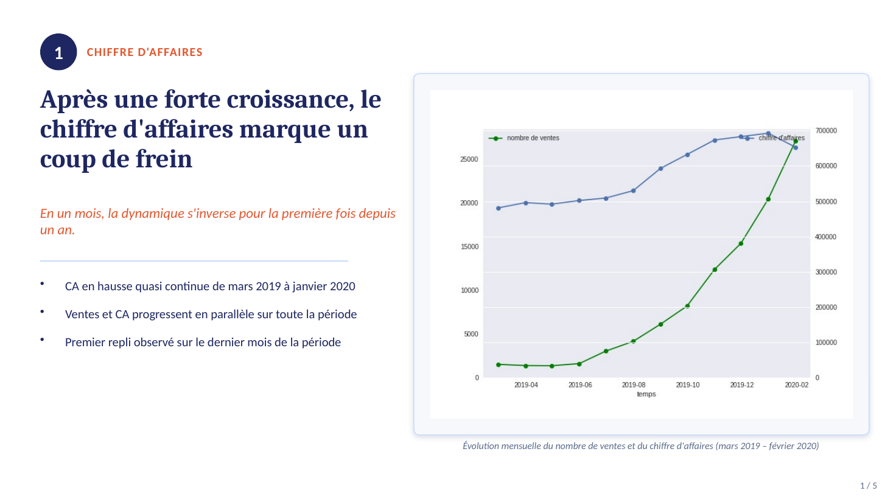
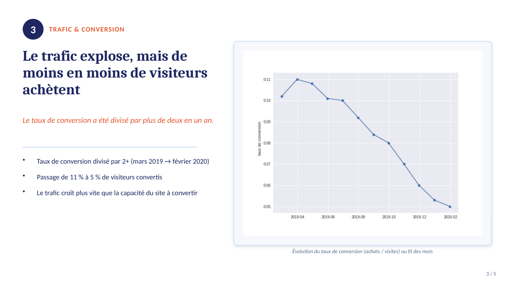
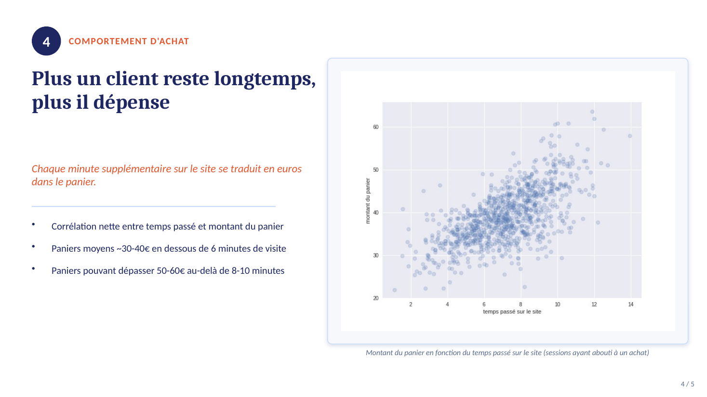
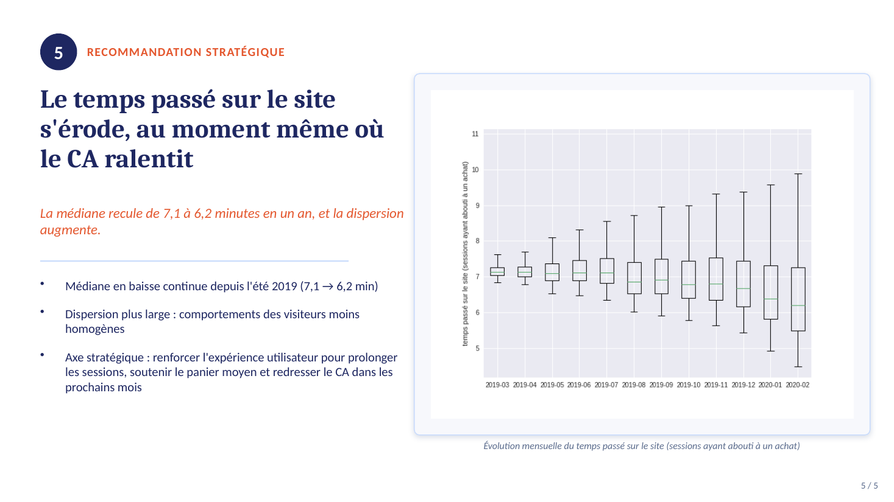
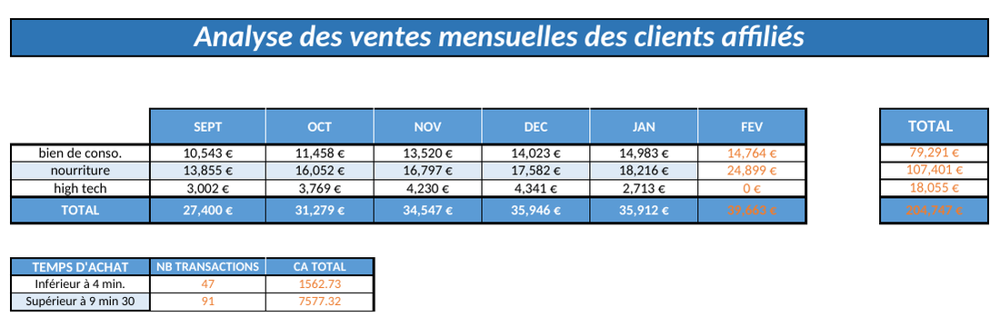
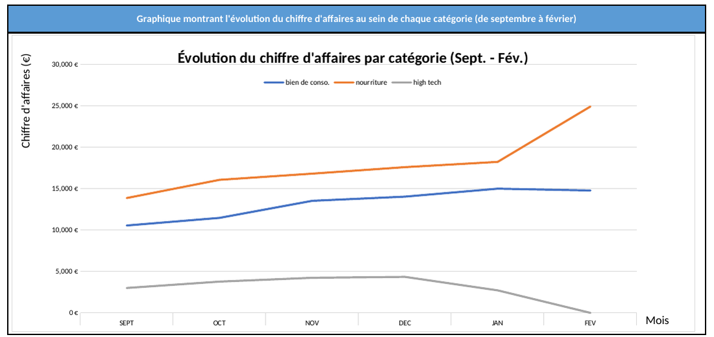
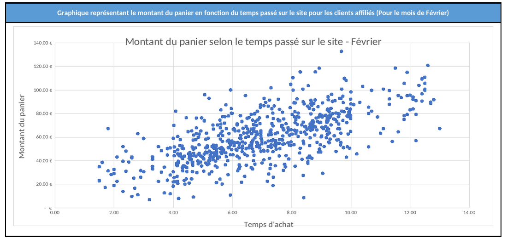
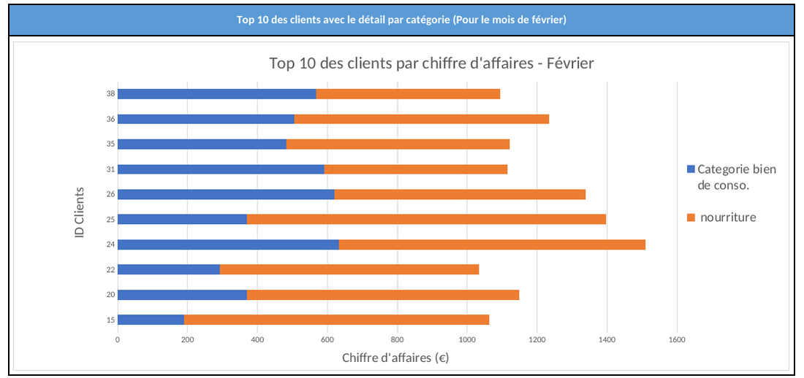
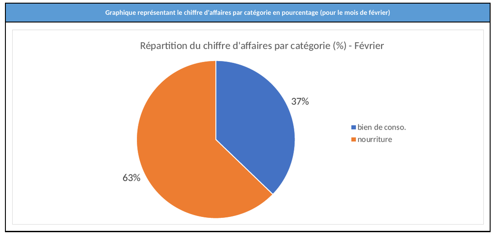

# 📊 Rapport marketing mensuel d'un e-commerce


> **Mission :** expliquer à la direction pourquoi le chiffre d'affaires ralentit, puis construire le tableau de bord mensuel des clients affiliés sous Excel.
>
> **Résultat :** le ralentissement vient de l'arrêt du high-tech et d'un taux de conversion divisé par deux. Ma recommandation : améliorer l'expérience sur le site pour allonger les visites, car le temps passé est directement lié au montant du panier.

---

## 🎯 En bref

| | |
|---|---|
| **Entreprise** | LGM, e-commerce de nourriture et de biens de consommation (cas fictif OpenClassrooms) |
| **Mon rôle** | Data analyst dans l'équipe marketing |
| **Livrables** | Une présentation de 5 diapositives pour la direction + un tableau de bord Excel |
| **Outils** | Excel (formules, tableau structuré, tableaux croisés dynamiques, graphiques) |

## 📈 Résultats clés

**Présentation à la direction (mars 2019 → février 2020)**
- 📉 Après un an de croissance quasi continue, le chiffre d'affaires **recule pour la première fois** en février 2020.
- 🔌 Ce recul coïncide avec **l'arrêt du segment high-tech**, qui pesait la majorité du CA. La nourriture et les biens de consommation progressent vite, mais ne compensent pas encore.
- 🛒 Le trafic explose, mais le **taux de conversion passe de 11 % à 5 %** en un an.
- ⏱️ Plus un client reste longtemps, plus il dépense, or **le temps passé sur le site recule** (médiane de 7,1 à 6,2 minutes).
- 💡 **Recommandation :** améliorer l'expérience utilisateur pour prolonger les visites et soutenir le panier moyen.

**Tableau de bord des clients affiliés (février 2020)**
- 💶 **39 663 €** de CA en février, soit **+10 %** par rapport à janvier et **+45 %** depuis septembre.
- 🥗 La nourriture représente **63 %** du CA de février (+37 % en un mois).
- ⏱️ Un achat réalisé en **plus de 9 min 30** rapporte en moyenne **83 €**, contre **33 €** pour un achat en moins de 4 minutes.
- 👥 660 achats pour 66 clients affiliés. Le meilleur client a dépensé 1 510 € sur le mois.

## 🏅 Retour du jury

✅ **Les 2 compétences évaluées sont validées** : concevoir des graphiques adaptés et accessibles, et proposer un récit des résultats avec des procédés narratifs.

> « Excellente soutenance. L'étudiant s'est très bien approprié le contexte et s'est réellement mis dans la peau du personnage attendu dans le cadre de la mission, ce qui a rendu la présentation particulièrement convaincante et professionnelle. »

> « L'étudiant ne se contente pas de présenter successivement des graphiques : il construit un véritable fil conducteur. […] Les transitions entre les différents graphiques sont particulièrement réussies. »

> « Le discours est suffisamment vulgarisé pour être compris par un interlocuteur non spécialiste de l'analyse de données. »

<!-- 🎥 Soutenance : ajouter ici le lien de la vidéo (YouTube non répertorié) -->

---

## 🗂️ Partie 1 : la présentation à la direction

**La demande :** le directeur marketing voulait comprendre d'où venait la baisse du chiffre d'affaires et comment la situation allait évoluer. Contraintes : 5 diapositives maximum, un graphique par diapositive, un discours accessible à des non-spécialistes de la data, et du storytelling.

**Ma démarche :** parmi les graphiques générés automatiquement par un script, j'ai sélectionné les 5 qui racontaient une histoire cohérente, du constat à la recommandation. Chaque titre de diapositive énonce le message, pas seulement le sujet.

| Diapo | Message |
|---|---|
| 1 | Après une forte croissance, le CA marque un coup de frein |
| 2 | Ce ralentissement coïncide avec la disparition du high-tech |
| 3 | Le trafic explose, mais de moins en moins de visiteurs achètent |
| 4 | Plus un client reste longtemps, plus il dépense |
| 5 | Le temps passé sur le site s'érode : il faut agir sur l'expérience utilisateur |

<p align="center">
  
  
</p>
<p align="center">
  
  
</p>

📄 [Voir la présentation complète (PDF)](rapport_mensuel.pdf)

---

## 📊 Partie 2 : le tableau de bord Excel des clients affiliés

**La demande :** compléter la trame de tableau de bord de l'équipe marketing avec les données de février, créer les graphiques et un tableau récapitulatif par client, en gardant les formules visibles et en respectant les bonnes pratiques d'accessibilité.

**Ce que j'ai fait :**
1. **Tableau structuré** (`Ctrl + T`) sur les 660 transactions de février, pour appeler les données par nom de colonne depuis n'importe quelle feuille.
2. **CA par catégorie** avec `SUMIF` :
   ```
   =SUMIF(Table_1[Categorie], B8, Table_1[Montant])
   ```
3. **Analyse du temps d'achat** avec `COUNTIF` et `SUMIF` :
   ```
   =COUNTIF(Table_1[Temps d'achat], ">9.5")
   =SUMIF(Table_1[Temps d'achat], ">9.5", Table_1[Montant])
   ```
4. **Tableaux croisés dynamiques** : récapitulatif du nombre d'achats et du CA par client et par catégorie, et Top 10 des clients.
5. **5 graphiques**, chacun choisi selon le message : courbes pour l'évolution, barres pour la comparaison, barres empilées pour le Top 10, nuage de points pour la relation temps / panier, camembert pour la répartition (2 catégories seulement).

<p align="center">
  
</p>

<p align="center">
  
  
</p>
<p align="center">
  
  
</p>

🖼️ [Voir le tableau de bord complet](images/dashboard-complet.png) · 📥 [Télécharger le fichier Excel](tableau_de_bord_affilies.xlsx)

---

## 🧠 Compétences démontrées

- **Analyse :** relier plusieurs indicateurs (CA, conversion, trafic, temps passé) pour expliquer une baisse
- **Excel :** tableaux structurés, `SUMIF` / `COUNTIF`, tableaux croisés dynamiques, graphiques croisés
- **Dataviz :** choisir le bon graphique pour chaque message, titres qui portent le message, accessibilité
- **Communication :** synthèse en 5 diapositives, storytelling, discours adapté à une direction non technique
- **Recommandation :** passer du constat à un axe stratégique concret

## 💭 Avec du recul

- Une corrélation n'est pas une causalité : les clients qui restent longtemps dépensent plus, mais ce n'est pas forcément *parce qu'*ils restent longtemps. Un test A/B sur l'expérience du site permettrait de le vérifier.
- Pour la prévision du CA des prochains mois, une analyse par série temporelle donnerait une estimation chiffrée plutôt qu'une tendance.

---

📁 **Fichiers du projet**

```
01-rapport-marketing-excel/
├── README.md
├── rapport_mensuel.pdf             ← présentation à la direction
├── tableau_de_bord_affilies.xlsx   ← tableau de bord Excel (formules visibles)
└── images/                         ← diapositives et graphiques
```

⬅️ [Retour au portfolio](../README.md)
