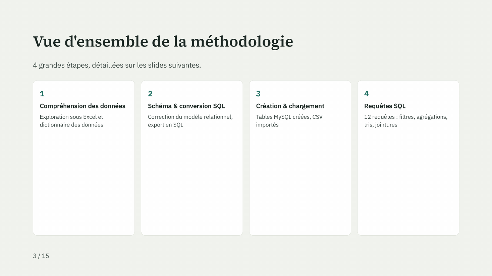
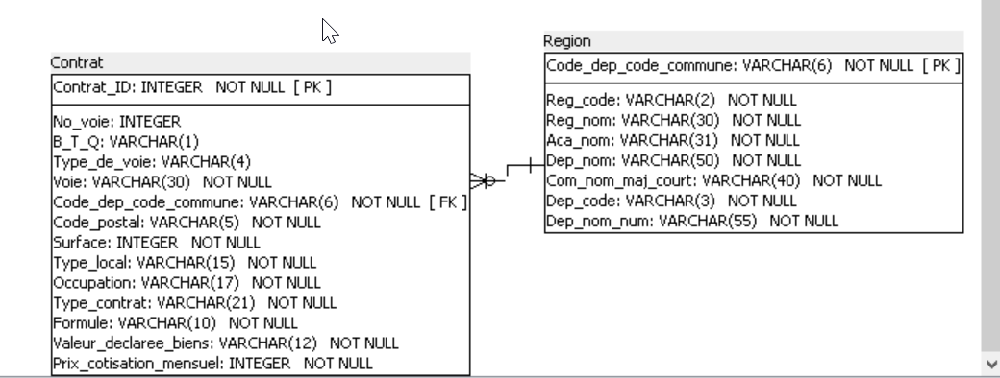
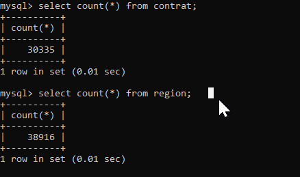
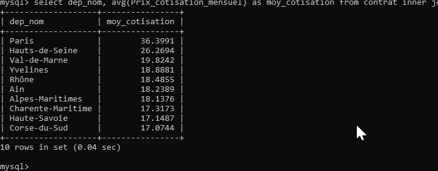
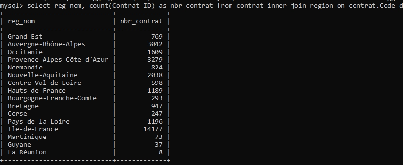

# 🏠 Analyse du marché de l'assurance habitation en SQL


> **Mission :** pour un assureur, construire de A à Z une base de données à partir de deux fichiers bruts (contrats et référentiel géographique), puis l'interroger en SQL pour analyser le portefeuille de contrats habitation.
>
> **Résultat :** une base MySQL de 69 251 lignes, modélisée, typée et contrôlée, et 12 requêtes qui révèlent un portefeuille très concentré : l'Île-de-France porte près de la moitié des contrats, et la cotisation à Paris est presque le double de la moyenne.

---

## 🎯 En bref

| | |
|---|---|
| **Entreprise** | Un assureur habitation (cas fictif OpenClassrooms) |
| **Données** | 30 335 contrats d'assurance + 38 916 communes françaises (référentiel data.gouv.fr) |
| **Livrables** | Dictionnaire des données, schéma relationnel, script SQL, base chargée, 12 requêtes, présentation de la méthodologie |
| **Outils** | Excel (exploration), SQL Power Architect (modélisation), MySQL |

## 📈 Résultats clés

- 🗺️ **L'Île-de-France concentre 47 % des contrats** (14 177), plus de 4 fois la 2e région (PACA, 3 279).
- 💶 **Cotisation moyenne : 19,33 € par mois.** À Paris, elle atteint **36,40 €**, presque le double. Les 4 premiers départements du classement sont franciliens.
- 🏡 **84 % des contrats** concernent une résidence principale (25 620).
- 📦 **75 % des assurés déclarent moins de 25 000 €** de biens (22 720 contrats).
- 🏙️ 20 communes dépassent 150 contrats, dont 12 arrondissements de Paris.
- 🗄️ **69 251 lignes chargées** et contrôlées (38 916 + 30 335), avec un traitement documenté des 9 contrats hors référentiel.

## 🏅 Retour du jury

✅ **Les 3 compétences évaluées sont validées** : charger des données dans une base, créer le schéma d'une base de données, rédiger des requêtes SQL pour aider à la décision.

> « Démarche d'exploration rigoureuse, typage des codes pertinent et justifié, et support de présentation clair et structuré. »

> « Très bonne compréhension des fondamentaux des requêtes SQL. »

---

## 🛠️ Ma démarche en 4 étapes

<p align="center">
  
</p>

### 1. Comprendre les données (Excel)

Avant de modéliser, j'ai observé chaque colonne des deux fichiers pour choisir son type, sa taille et ses contraintes :

| Formule Excel | Ce qu'elle vérifie |
|---|---|
| `NB.VIDE(plage)` | Colonne avec des vides ou non → `NULL` ou `NOT NULL` |
| `NBVAL(plage)` | Nombre de valeurs renseignées |
| `MAX(NBCAR(plage))` | Longueur maximale d'un texte → taille du `VARCHAR` |
| Filtres / TCD | Valeurs distinctes → type réel de la colonne |

Résultat : un **dictionnaire des données** complet (22 colonnes : nom, type, taille, clé, description).

### 2. Corriger et compléter le schéma relationnel (SQL Power Architect)

Par rapport à l'ébauche fournie : colonnes manquantes ajoutées, tailles ajustées aux données réelles, clés primaire et étrangère définies.

**Choix clé : les codes en `VARCHAR`, pas en `INT`.** Stocké en nombre, le code postal `01370` perd son zéro et devient `1370`, et le département `2A` (Corse) est impossible à stocker.

<p align="center">
  
</p>

📄 [Script de création des tables](sql/01_creation_tables.sql)

### 3. Créer la base et charger les données (MySQL)

- Création de la base et exécution du script généré
- Import des CSV avec `LOAD DATA LOCAL INFILE` : la table Region d'abord, puis Contrat, à cause de la clé étrangère
- **Contrôle du nombre de lignes** entre les fichiers et la base
- **Anomalie détectée :** 9 contrats ont un code commune absent du référentiel (codes de La Réunion hors liste). Je les ai importés pour garder toutes les lignes du fichier, en le documentant. Ils sont exclus des analyses par région.

<p align="center">
  
</p>

📄 [Script de chargement](sql/02_chargement_donnees.sql)

### 4. Interroger la base : 12 requêtes

| Technique | Requêtes |
|---|---|
| Filtrer (`WHERE`, `DISTINCT`) | Contrats d'un code postal, liste des régions, résidences principales |
| Agréger (`COUNT`, `AVG`, `GROUP BY`) | Cotisation moyenne, contrats par tranche de valeur |
| Trier et limiter (`ORDER BY`, `LIMIT`) | Top 5 des surfaces, top 10 des départements |
| Joindre deux tables (`JOIN`) | Formules en Pays de la Loire, maisons du 71, surface moyenne à Paris |
| Filtrer des groupes (`HAVING`) | Communes avec au moins 150 contrats |

**Exemple : le top 10 des départements par cotisation moyenne**

```sql
SELECT r.Dep_code, r.Dep_nom, ROUND(AVG(c.Prix_cotisation_mensuel), 2) AS cotisation_moyenne
FROM Contrat c
JOIN Region r ON c.Code_dep_code_commune = r.Code_dep_code_commune
GROUP BY r.Dep_code, r.Dep_nom
ORDER BY cotisation_moyenne DESC
LIMIT 10;
```

<p align="center">
  
  
</p>

📄 [Les 12 requêtes commentées, avec leurs résultats](sql/03_requetes_analyse.sql) · 📑 [Captures de tous les résultats (PDF)](livrables/requetes_et_resultats.pdf)

---

## 🧠 Compétences démontrées

- **Exploration de données :** analyser chaque colonne avant de modéliser (vides, longueurs, valeurs distinctes)
- **Modélisation :** dictionnaire des données, schéma relationnel, clés primaire et étrangère, choix des types
- **Base de données :** création sous MySQL, import de CSV, contrôle de complétude, gestion d'une anomalie de référentiel
- **SQL :** `WHERE`, `GROUP BY`, `HAVING`, `ORDER BY`, `LIMIT`, `JOIN`, fonctions d'agrégation
- **Communication :** présentation de la méthodologie en 15 diapositives

## 💭 Avec du recul

- **Lire chaque mot de la question.** « Au moins 150 contrats » s'écrit `>= 150` et non `> 150`, et « les numéros de contrats avec leur surface » demande ces deux colonnes, pas `SELECT *`. Les requêtes publiées ici sont corrigées en ce sens.
- **Regrouper par identifiant, pas par nom.** Plusieurs communes françaises portent le même nom : un `GROUP BY` sur le nom peut additionner des villes différentes. Je regroupe désormais par code commune.
- **Les 9 contrats hors référentiel.** Plutôt que de désactiver la contrainte de clé étrangère, une alternative plus propre aurait été de compléter le référentiel, ou de les isoler dans une table de rejets.

---

📁 **Fichiers du projet**

```
02-assurance-habitation-sql/
├── README.md
├── sql/
│   ├── 01_creation_tables.sql
│   ├── 02_chargement_donnees.sql
│   └── 03_requetes_analyse.sql
├── livrables/
│   ├── document_technique.pdf          ← dictionnaire, schéma, script, base chargée
│   ├── requetes_et_resultats.pdf       ← les 12 requêtes et leurs captures
│   └── presentation_methodologie.pdf   ← support de soutenance
└── images/
```

⬅️ [Retour au portfolio](../README.md)
